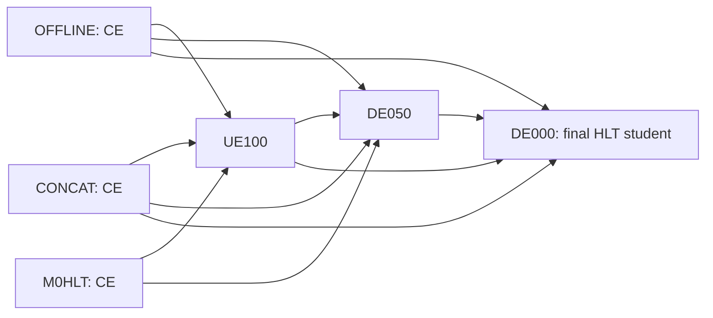

# FullStat equal-class/equal-pT campaign: OFFLINE, M0HLT, CONCAT and UE100 → DE050 → DE000

Date: 2026-11-13. Version 1 scientific design and implementation handoff.

Status: implemented in the isolated `luka_fullstat_balanced_ladder` namespace.
See the [queue runbook](../LUKA_FULLSTAT_BALANCED_LADDER_RUNBOOK.md),
[v1 contract](../contracts/LUKA_FULLSTAT_BALANCED_LADDER.md) and
[validation evidence](../LUKA_FULLSTAT_BALANCED_LADDER_VALIDATION.md).
Local queue readiness does not establish real Oscar acceptance; each science
allocation performs the integrated checks below. No Oscar jobs were submitted.

## 1. Campaign at a glance

Train six fresh models on the same balanced TRAIN draw distribution:

1. A pure-OFFLINE CE reference and teacher.
2. An HLT-only CE reference, M0HLT.
3. A CE teacher using the source-blind union of HLT and OFFLINE particles, CONCAT.
4. UE100, supervised by OFFLINE, CONCAT and M0HLT.
5. DE050, supervised by OFFLINE, CONCAT, UE100 and M0HLT.
6. HLT-only DE000, supervised by OFFLINE, CONCAT, UE100 and DE050, with additional
   pure-OFFLINE instance contrastive matching.

Every ladder teacher supplies both its native embedding and its softened native
class probabilities. Embedding and logit predictions have separate auxiliary
heads. The deployed classifier consumes only its own HLT representation.

All six models use equal class sampling and equal 100 GeV pT-bin sampling within
each class, over `200 <= offline jet_pt < 2000 GeV`. Each model trains for 20
sampling epochs, with 2,425,536 replacement draws per epoch and batch size 128.

This tests the complete balanced-training strategy with a short teacher ladder.
It does not isolate the effects of flattening, embedding supervision, auxiliary
KD, or contrastive matching individually. Better recovery is a hypothesis,
not an admission or completion requirement.

## 2. Population and chosen pT range

Preserve the existing authenticated FullStat paired-row split:

| Original role | Jets | Use in this campaign |
| --- | ---: | --- |
| TRAIN | 3,000,000 | Apply the agreed pT eligibility cut within this role |
| Development validation | 500,000 | Preserve membership and ordering for evaluation |
| Final test | 1,500,000 | Remains sealed |
| Unused | 105,325 | Remains unused |

The balancing coordinate is the saved **offline reconstructed jet-level
`jet_pt` in GeV**. Use this same scalar for every model and every paired view.
It is neither constituent pT, a QCD generation-bin label, nor pT recomputed
separately from each student's inputs. Offline pT is authorized training
selection metadata; it is not an added deployable input.

The eligible TRAIN population contains **2,425,536 unique jets**, retaining
80.8512% of the original TRAIN population. The other 574,464 TRAIN jets are
excluded from these fits, not deleted or moved into another split. Do not
replace them with validation, test or previously unused rows.

| Class | Eligible TRAIN jets |
| --- | ---: |
| QCD | 1,760,087 |
| X_bb | 88,988 |
| X_cc | 87,191 |
| X_ss | 85,841 |
| X_qq | 85,594 |
| X_gg | 90,926 |
| X_ee | 38,814 |
| X_mm | 40,598 |
| X_tauhtaue | 37,838 |
| X_tauhtaum | 36,913 |
| X_tauhtauh | 72,746 |
| **Total** | **2,425,536** |

These are available unique rows, not the target training class proportions.

Use exactly 18 half-open bins: `[200,300), [300,400), ..., [1900,2000)`.
A jet at 200 GeV is included; a jet exactly at 2000 GeV is excluded.
All 198 class/bin cells are populated in the saved audit. The implementation
must reproduce the audited cell counts from the authenticated TRAIN metadata
before fitting. Empty cells or count mismatches stop preparation; they must not
trigger silent bin merging, population expansion or a different sampling law.

No mass or eta flattening is part of this campaign. The 2000 GeV cutoff and
100 GeV bin width are the user's chosen recipe following the occupancy audit;
they are not asserted to be a universal CMS-prescribed binning.

### Evidence for the counts

The copied Oscar bundle is
`reports/fullstat_pt_audit_0810779d_r1/report.json`, generated with audit source
`0810779da6143de4616c1e34f71fe0fbc2b6c0eb`. Its content hash is:

```text
8383cbacb0aeb7664a534ab5e8f3287b8e67c4963dbe69e7c90146786c25522c
```

The local comparison bundle is `reports/fullstat_pt_compare_local_r1/`.
The `flat100_2000` projection was also recomputed directly from the authenticated
audit with `draws=2425536, epochs=20` for the budget specified here. The original
comparison's 3M-draw repetition estimates must not be quoted as estimates for
this smaller draw budget. See the [audit plan](LUKA_FULLSTAT_PT_AUDIT_PLAN.md)
and [saved-histogram comparison contract](../contracts/LUKA_FULLSTAT_PT_COMPARISON.md).

## 3. Sampling law and the meaning of an epoch

For each draw, independently:

1. Choose one of the 11 classes uniformly.
2. Choose one of its 18 pT bins uniformly.
3. Choose a canonical eligible TRAIN jet uniformly from that cell, with replacement.

For a jet `j` in class/bin cell `(c,b)` containing `n_cb` jets:

```text
P(class=c) = 1/11
P(bin=b | class=c) = 1/18
P(j) = 1 / (11 * 18 * n_cb)
```

Use this same query distribution for OFFLINE, M0HLT, CONCAT, UE100, DE050 and
DE000. All losses are ordinary batch means on these draws. Do not additionally
apply inverse-frequency class/pT loss weights: that would rebalance twice.

Balance is exact in the target probabilities and approximate in finite sampled
counts. It is not an exact quota in every minibatch or epoch, nor a guarantee
that pT is continuously uniform inside each 100 GeV bin. Replacement permits
the same jet to occur more than once, including within a batch.

| Budget per model | Value |
| --- | ---: |
| Eligible unique TRAIN jets | 2,425,536 |
| Draws per epoch | 2,425,536 |
| Epochs | 20 |
| Total draws | 48,510,720 |
| Batch size | 128 |
| Updates per epoch | 18,950 |
| Last batch of each epoch | 64 draws |
| Total updates | 379,000 |

An epoch is now a fixed draw budget, not one traversal of every eligible jet.
Do not implement it as a shuffled without-replacement pass through all rows.
Keep the final partial batch; do not silently drop it, pad it with extra draws,
or change the budget to make it divisible by 128.

At this budget, the histogram projection gives about 815,609 distinct jets
seen per epoch and 66.4% repeated draws. The sparsest cell is X_tauhtaum at
1900–2000 GeV, with 252 jets and 48.61 expected appearances per jet per epoch.
Across 20 epochs, about 2,143,307 distinct eligible jets are expected to be
seen. These are expectations, not guaranteed realized counts or proof of
overfitting. Save realized class/bin counts and distinct-exposure diagnostics.

### Reproducibility defaults to implement

Use a dedicated versioned sampler stream, independent of model, dropout,
auxiliary-head, diagnostic and contrastive RNG. Materialize or deterministically
regenerate each epoch's ordered canonical draw indices. Use the same draw
sequence for all six fits so data order is controlled across views.

Bind the eligible identity order, cell index arrays, probabilities, draw budget,
sampler algorithm/version and seed in the new immutable spec. Persist an epoch
draw-sequence hash. Numeric seeds must be fixed before dry review and must not
depend on a timestamp, scheduler job ID or worker count.

Repeated queries must gather the same paired target row correctly; unique
identity is a bank invariant, not a requirement on the sampled batch. Resume
must restore the same sequence and completed-update position. Prefetching must
not change scientific RNG state or skip draws.

## 4. Models and supervision graph

All six fits start from scratch. A ladder arrow means that a selected, frozen
model supplies training targets; it does not mean initializing the next rung
from that model's weights.

| Fit | Input | Teachers for both embedding and auxiliary logit prediction | Contrastive target |
| --- | --- | --- | --- |
| OFFLINE | Native pure OFFLINE | None; CE only | None |
| M0HLT | Native HLT / D000 | None; CE only | None |
| CONCAT | Full source-blind HLT + OFFLINE particle union | None; CE only | None |
| UE100 | U100 | New OFFLINE, new CONCAT, new M0HLT | None |
| DE050 | D050 | New OFFLINE, new CONCAT, new UE100, new M0HLT | None |
| DE000 | Native HLT / D000 | New OFFLINE, new CONCAT, new UE100, new DE050 | New pure OFFLINE |

M0HLT supervises the two intermediate rungs. It is not a final DE000 target.
DE000 retains direct supervision from the richer teachers as well as the
immediately preceding rung. Every teacher in this table is newly trained with
this campaign's balanced distribution; historical checkpoints are not substituted.

The dependency structure is:



### Input definitions

Reuse the authenticated FullStat endpoint views, paired identities and existing
physical ladder construction. Do not substitute an older proxy dataset.

- **U100:** the HLT-cardinality shell, with matched slots carrying offline
  measurements and unmatched HLT slots retained. No offline-only tail remains.
- **D050:** exactly one-half retained offline contribution on matched slots,
  with the existing physical four-vector interpolation, atomic discrete
  identity choices and validity-aware tracking semantics. This does not mean
  randomly deleting half the particles. Unmatched HLT slots remain present.
- **D000:** exactly the authenticated native HLT endpoint, including its full
  particle support. No offline feature, pairing index or degradation index is
  exposed to the deployable model.

CONCAT uses the existing full physical multiset union and common feature
transform. Retain both HLT and OFFLINE measurements without matching or
deduplication, source tags, positional source encoding or separate source
normalization. Apply source-blind ordering and retain the complete union.
Measurement characteristics can still reveal origin statistically; absence
of a source tag does not make origin fundamentally unidentifiable. CONCAT is
a privileged teacher, not a physical reconstructed single jet.

Only M0HLT and DE000 are deployable HLT-only models. OFFLINE, CONCAT, UE100 and
DE050 are privileged references/teachers.

## 5. Exact losses and heads

The three CE reference/teacher fits use native 11-class CE with coefficient 1.
For each ladder fit with teacher set `T_stage`, `N = len(T_stage)`:

```text
L = CE(main_logits, y)
  + (10/N) * sum_t SmoothL1(embedding_head_t(h), standardized_native_embedding_t)
  + ( 1/N) * sum_t [T^2 * KL(q_t^T || p_aux_t^T)]
  + lambda_contrast(update) * L_contrast        # final DE000 only

T = 2
q_t^T = softmax(frozen_native_teacher_logits_t / T)
p_aux_t^T = softmax(auxiliary_logit_head_t(h) / T)
```

| Fit | Main CE | Embedding coefficient per teacher | KD coefficient per teacher, before T² | Contrastive |
| --- | ---: | ---: | ---: | --- |
| OFFLINE / M0HLT / CONCAT | 1 | 0 | 0 | 0 |
| UE100, three teachers | 1 | 10/3 | 1/3 | 0 |
| DE050, four teachers | 1 | 2.5 | 0.25 | 0 |
| DE000, four teachers | 1 | 2.5 | 0.25 | Ramp to 0.3 |

Thus every ladder fit has total embedding coefficient 10 and total auxiliary
KD coefficient 1, independent of teacher count. These are experimental weights,
not percentages of the realized total loss or guaranteed gradient magnitudes.
The CE, embedding and KD coefficients are constant from the first update.

Use native 128-dimensional encoder representations. Each teacher has its own
embedding MLP `Linear(128,128) -> GELU -> Linear(128,128)` and its own auxiliary
logit head `Linear(128,11)`. Initialize auxiliary heads in isolated RNG streams.
SmoothL1 uses beta 1 and a mean over rows and embedding coordinates. KD uses
forward teacher-to-student KL, summing classes and averaging rows, with T²
applied exactly once. Keep auxiliary predictions/losses in FP32.

The native classification head is supervised directly only by CE. Auxiliary
objectives update the shared encoder but do not directly supervise that head.
Neither teacher outputs nor predicted teacher outputs are concatenated into
the main classifier. Remove every auxiliary head at deployment and verify that
the exported native HLT model reproduces selected DE000 predictions.

## 6. Teacher targets and export

Freeze each teacher at its selected development-validation checkpoint before
export. Export its **own native** embedding and **own native main-head** T=2
probabilities. A teacher that was itself distilled must not export its predicted
embedding, auxiliary logits, or an average of its teachers as its native target.

Produce one target row per unique eligible TRAIN identity, not per replacement
draw. During training gather targets by the sampled canonical row indices.
Export once; do not execute teacher forwards during student optimization.

Implementation default: calculate separate per-teacher embedding means and
standard deviations on the unique eligible TRAIN population, with FP64 population
moments, standard-deviation floor 1e-3, and FP32 stored standardized targets.
These moments are not recomputed on each sampled epoch and do not include
validation/test rows. Equal sampling governs optimization; normalization has
this separately declared unique-TRAIN population. Never average different
teachers' embedding coordinates or normalization statistics.

OFFLINE, CONCAT, M0HLT, UE100 and DE050 publish outgoing TRAIN embedding and
probability banks. DE000 needs no outgoing teacher bank. OFFLINE also supplies
the contrastive key bank derived from its standardized native embeddings.

Each manifest binds the exact teacher checkpoint/report, input coordinate,
eligible identities/order, labels, normalization population, source inventory,
recipe and payload hashes. Historical banks over a different population or
trained under the old sampling law are not interchangeable with these banks.
Publication is atomic; path existence alone never authorizes reuse.

## 7. Final DE000 contrastive objective

Match the HLT query to its paired pure-OFFLINE jet, using the newly trained
OFFLINE teacher. Do not match against CONCAT, an intermediate rung or a second
copy of the same HLT input.

The independent matching head is `Linear(128,128) -> GELU -> Linear(128,128)`.
L2-normalize its output and the OFFLINE standardized keys in FP32 with epsilon
1e-12. For each query use its positive at candidate index zero and 1,024 distinct
negative eligible TRAIN identities:

```text
L_contrast = CE(cosine(query, candidate_keys) / 0.1, positive_index=0)
lambda_contrast(u) = 0.3 * min(1, u / (3 * 18950))
```

Here `u` is the one-based global optimizer update. The ramp reaches 0.3 at the
end of sampling epoch 3. There is no contrastive loss in UE100 or DE050.

Reuse the proven `mix` candidate construction: 256 hard, 256 same-class and
512 global negatives. Hard mining uses 4,096 balanced different-class proposals
and ranks 257–1024, with canonical-identity tie handling. Assemble H, then S,
then G, excluding the positive and previously selected components; exclude
known authenticated event/alias groups where available. Preserve the donor
within-component probability and exclusion rules.

Restrict every candidate source to eligible TRAIN rows. The negative sampling
distribution is distinct from the equal-class/equal-pT **query** sampler;
do not silently apply query flattening to the contrastive components. No
validation or test key may enter mining.

Replacement introduces repeated query occurrences, which the old one-pass
sampler did not have. Implementation default: key the candidate RNG by the
declared seed, epoch, canonical identity, draw position, component and stream.
This gives repeat occurrences reproducible fresh candidate draws. Version this
adapter explicitly and compare optimized kernels against a serial reference
with the same occurrence keys. Do not claim byte-identical old candidate
streams after changing the eligible pool or RNG keys.

Reuse bounded candidate prefetch, persistent workers, batched transfers and
frozen-key GPU mining from the [FullStat contrastive plan](LUKA_FULLSTAT_MULTI3_CONTRASTIVE_PLAN.md).
Do not reduce candidate count, particle support, precision or scientific batch
size as an unrecorded speed optimization. Event-level independence remains
unverified where the source cannot certify it.

## 8. Common optimization and checkpoint selection

Retain the FullStat 20-epoch training settings for all six models:

- Batch 128, no gradient accumulation, fixed 20 epochs without early stopping.
- AdamW, betas `(0.9, 0.999)`, epsilon `1e-8`, weight decay `0.01`, preserving
  the existing parameter-group exclusions.
- BF16 model forward and FP32 losses, using the existing native model path.
- Two-epoch linear learning-rate warmup to `3e-4`, then cosine decay to
  `1.5e-5` at epoch 20.
- Full development-validation evaluation after each epoch.

Use the new sampling epoch coordinate `position = update / 18950` in the
existing FullStat learning-rate function. The old 23,438-update epoch must
not survive in schedules, contrastive ramps, progress reports or resume logic.
This budget has about 19.15% fewer draws per fit than the historical 3M-draw,
20-epoch runs, so those old experiments are not matched training controls.

Preserve the selection key: maximum main-head macro one-versus-rest AUC,
then minimum CE, then maximum macro mean log R50, then earliest update.
The existing undefined-log-rejection handling remains unchanged. Select
embeddings/logits from that one checkpoint per teacher, and evaluate DE000
with the same rule. Never select a different checkpoint for each class or
rejection efficiency.

## 9. Validation and recovery reporting

Evaluation default: retain the same original 500,000 validation rows, natural
class/pT distribution and ordering for the primary full-validation selection
and reporting. Do not sample validation with replacement or rebalance it using
the TRAIN sampler. This preserves the previous selection population while
making the changed training regime explicit.

Also report the shared `200 <= offline jet_pt < 2000` validation subset and
per-100-GeV-bin results, plus a separately labeled outside-range diagnostic.
The validation subset count must be measured; it is not inferred from the
TRAIN retention fraction. Apply the same masks to every compared model and
keep the full-validation-selected checkpoint for all these views. Missing
classes or insufficient background counts produce labeled unresolved metrics,
not invented rejection values or a failed scientific fit.

Report macro OVR AUC, accuracy, CE, and per-class QCD rejection at signal
efficiencies 50% and 30%. Rejection uses
`p(signal)/(p(signal)+p(QCD))`, the existing descending-signal-rank threshold
with ties included, and saved passing/background counts. Zero QCD passing is
censored rather than measured infinite rejection.

Use the newly trained balanced M0HLT and OFFLINE as the recovery anchors:

```text
recovery_percent = 100 * (model_metric - new_M0HLT_metric)
                       / (new_OFFLINE_metric - new_M0HLT_metric)
```

Calculate this separately for each metric, class, efficiency and evaluation
population. Report a zero/nonpositive reference gap or censoring explicitly
rather than presenting it as ordinary recovery. Negative recovery and recovery
above 100% are possible when the denominator is valid.

The old `0.96552387` / `0.96980545` AUC anchors are historical context only.
They must not be hard-coded as this campaign's primary denominator. Report
absolute metrics alongside recovery because a changed baseline gap can change
the percentage without a corresponding improvement in absolute performance.
Accuracy on natural validation is prevalence-dependent; a balanced training
prior need not improve natural-prior accuracy. No calibration/prior correction
or ensemble weight fitting is silently added to this campaign.

All results remain single-seed development-validation evidence. The final test
stays sealed; neither target construction nor diagnostics require test inference.

## 10. Oscar execution design

Register exactly six scientific fits. OFFLINE, M0HLT and CONCAT are independent
and may run concurrently if resources permit. UE100 waits for all three fits
and their authenticated exports; DE050 waits for UE100 and its other teachers;
DE000 waits for DE050 and all its other teacher artifacts. Use `afterok` for
scientific dependencies and verify receipts again in each worker.

Teacher exports and publication belong to their corresponding fit allocations.
Additional export or recovery operations are not additional scientific fits.
Finite disappointing metrics must not cancel later rungs or suppress results.
Corrupt inputs, wrong lineage, forbidden data access, nonfinite required values
or technical resource failures fail closed.

Use exact pushed source, a complete dry plan, exclusive submission claims,
append-only journals and a detached launcher. After the launcher establishes
its durable process record, SSH/tail is only an observation channel. Do not
silently resubmit after an ambiguous scheduler response.

The intended Oscar workflow performs installed-Weaver parity, sampler/target
checks, full-support gradient stress, and resource admission inside the actual
allocations before resetting to fresh scientific initialization. It does not
add a separate full training preflight. This Oscar design follows the existing
campaign-specific integrated acceptance approach; local tests do not establish
real Oscar acceptance or satisfy measured-resource requirements by themselves.

CONCAT remains potentially expensive because its full union has more particles.
The previous CONCAT fit took about 22 hours 27 minutes. Six times ten hours is
therefore not a measured runtime forecast. Implementation clarification: freeze
the conservative **request envelope** before submission, and measure/admit the
new objective inside its allocation before scientific optimization. This resolves
the earlier wording that asked for new measurements before submission while
also prescribing integrated acceptance without a separate preflight.

The v1 requests are one L40S, six CPUs,192000MiB RAM and48h per stage, four
preparation workers and three candidate workers. Allow32GiB new result artifacts
plus4GiB headroom, requiring36GiB available quota. The48h ceiling is not a new
runtime measurement. Integrated timings include preparation,64 complete balanced
updates,16 validation and16 outgoing dual-export forwards; admission budgets
remaining epochs, selected validation and export with a1.3 timing factor and
60min fixed overhead reserve. Full-support CPU/GPU memory checks include target
export and candidate-worker headroom. Save evidence before refusing an envelope;
do not shorten training, crop particles or change sampling to make it fit.

Save complete model, auxiliary heads, AdamW, RNG, sampler position and schedule
state atomically at every completed epoch. Resume must preserve the registered
20-epoch draw schedule. If optimization completed and export/publication failed,
support explicit publication-only recovery from the saved selected state.
Keep failed attempts and bind any recovery to them; do not retrain by default.

## 11. Implementation map and acceptance work

The following donor reuse points are implemented in the new namespace:

| Area | Existing code or contract | Required adaptation |
| --- | --- | --- |
| TRAIN occupancy and half-open cuts | [audit](../../src/hlt_classification/operations/fullstat_pt_audit.py), [comparison](../../src/hlt_classification/operations/fullstat_pt_comparison.py) | Build and authenticate the row-level eligible population and 198 cell indices |
| Paired input coordinates | [view construction](../../src/hlt_classification/cms_proxy_ladder/views.py) | Register U100, exact D050 and D000 on the same eligible identities |
| CONCAT | [multiview views](../../src/hlt_classification/luka_fullstat_multiview/views.py), [model](../../src/hlt_classification/luka_fullstat_multiview/model.py) | Fresh CE fit with the shared sampler and complete union support |
| Split-head losses | [training](../../src/hlt_classification/luka_fullstat_splithead/training.py), [contract](../contracts/LUKA_FULLSTAT_SPLITHEAD.md) | New stage teacher maps, CE1/KD1/E10, fresh banks and replacement draws |
| Contrastive objective and optimized sampling | [training](../../src/hlt_classification/luka_fullstat_multi3_contrastive/training.py), [sampling](../../src/hlt_classification/luka_fullstat_multi3_contrastive/sampling.py), [contract](../contracts/LUKA_FULLSTAT_MULTI3_CONTRASTIVE.md) | Eligible-only OFFLINE keys and occurrence-keyed RNG for repeated queries |
| Optimizer/schedule and selection | [FullStat recipe](../../src/hlt_classification/luka_fullstat/recipe.py), [selection key](../../src/hlt_classification/jetclass2_delphes/runner.py) | New steps-per-epoch and explicit new sampling/objective fields |
| Submission and recovery | [multiview submission](../../src/hlt_classification/luka_fullstat_multiview/submission.py), [contrastive recovery](../../src/hlt_classification/luka_fullstat_multi3_contrastive/recovery.py) | Six-fit DAG, fresh result roots, new artifact bindings and deterministic continuation |

Use a new campaign namespace, proposed
`LUKA_FULLSTAT_BALANCED_LADDER_<KIND>/v1`; do not make old and new artifacts look
interchangeable. Separate original TRAIN membership count, eligible unique count,
epoch draw count and realized unique exposure in schemas. Do not globally replace
historical `train=3000000` constants. Inherited recipe fields describing one-pass
sampling or the older CE/KD weights must be explicitly overridden and validated.

Actual donor files and commit are recorded in `docs/LEGACY_SOURCE_MAP.md`.
The v1 sampler seed is2026111301, common native initialization2026111302,
matching-head seed2026111303 and negative RNG seed2026111304. Independent
embedding/logit head seeds use explicit SHA256 domain/teacher names in
`contracts.seed`. Executable source is pinned to the pushed commit supplied at
launch; the contract/runbook define resources, fresh roots and exact submission.

Focused acceptance coverage must include:

- Audited class/bin counts, half-open boundaries, no role leakage, corrupt-input
  rejection and deterministic sampler replay independent of worker scheduling.
- Equal target probabilities, repeated-identity gathering, final partial batches,
  full draw budget and restart equivalence without skipped or duplicated updates.
- Identical eligible identities across views; native D000 parity; exact D050
  construction; complete, source-blind CONCAT support.
- Native teacher-bank provenance and eligible-TRAIN normalization, with no
  validation/test contribution and no substitution of auxiliary teacher outputs.
- Exact loss coefficients/reductions, no direct auxiliary gradient into the main
  classifier, auxiliary gradient into the encoder, and native deployment parity.
- Contrastive positive exclusion, distinct negatives, repeated-query RNG behavior,
  serial/optimized candidate parity, and the three-new-epoch ramp.
- Validation row alignment, fixed checkpoint selection, fresh recovery anchors,
  censored rejection counts and separately labeled population masks.
- Atomic checkpoint/export recovery, source/receipt validation and the exact
  six-fit dependency plan. Real Oscar timing and memory evidence remains required.

## 12. Relationship to previous experiments

The earlier successful split-head continuation used DE066 → DE033 → DE000,
reused hybrid UE100, and weighted main CE 0.5, total auxiliary KD 0.5 and total
embedding loss 5. Its final targets were OFFLINE, hybrid UE100, new DE066 and
new DE033. The later DE022 → DE011 → DE000 fine tail used CE0.5/KD1/E40 with a
larger cumulative target set; its final model was subsequently fine-tuned.

The historical Multi3 + contrastive model predicted U100, CONCAT and FUSION
embeddings with total weight 10 and matched pure-OFFLINE keys at contrastive
weight 0.3. Pure OFFLINE was its matching source, not one of those three
embedding targets. That comparison improved reported AUC-gap recovery from
about 31.9% to 34.6% under the old sampling regime; it is motivation for using
contrastive matching here, not a predicted gain for the new campaign.

This plan combines fresh balanced references and CONCAT with a short
UE100 → DE050 → DE000 split-head ladder and final-stage contrastive matching.
It includes no FUSION fit, subclass objective, relational loss, DE022/DE011
extension, retained predictor, fine-tuning stage or hyperparameter sweep.
Next: commit/push the scoped implementation and queue the documented detached
launcher. Real Oscar acceptance remains required inside each allocation.
