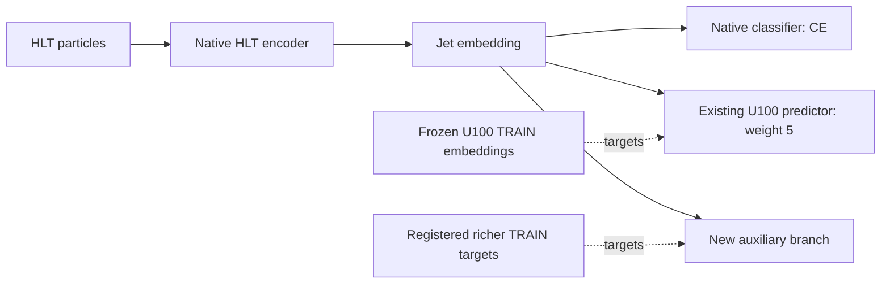

# Next HLT supervision campaign: seven training-only supervision ideas

Status: research catalog v0.8, 2026-11-05. This is the growing design document
requested by the user. The first seven ideas are described here; more ideas can
be added as later groups are implemented. Group A now has an additive
[implementation contract](../contracts/LUKA_NEXT_SUPERVISION_HYDRA.md) and
[Hydra runbook](../LUKA_NEXT_SUPERVISION_GROUP_A_RUNBOOK.md). Group B now extends
the same foundation with [Q/V contracts](../contracts/LUKA_NEXT_SUPERVISION_GROUP_B.md)
and a [Brown runbook](../LUKA_NEXT_SUPERVISION_GROUP_B_RUNBOOK.md); C remains future work.
The proposed defaults below are
research judgments, not measured optima or a promise of 45%+ recovery.

The [three-group implementation and40-row proposal](LUKA_SEVEN_CANDIDATE_IMPLEMENTATION_PLAN.md)
selects the proposed first campaign from this wider catalog. Family descriptions
and variants below are the research catalog, not an instruction to queue them all.
All selected science fits are submitted independently, with no dependencies
between fits; only the interleaved submission order encourages mixed execution.
This document does not create executable workers, authorize submissions, or
change an existing campaign. Existing immutable
specifications and versioned contracts retain their meaning. Retrieval from an
offline training memory is outside this proposal, following the user's preference.
The larger-HLT-model/compression route is also outside the campaign: the user
wants to study better privileged supervision at fixed deployed architecture.
The proposed learned shared-space objective has not been selected for inclusion.
Particle-soup membership (idea05, family P) is the user's current highest-priority
candidate. Its distractor-sampling comparisons should receive early slots when
the eventual submission order is frozen, alongside compatible matched references.
This preference does not introduce dependencies or performance-based stopping.

## 1. Objective and evidence motivating the change

Improve a deployable HLT classifier beyond the established CE + U100 embedding
prediction at weight 5. Preserve native student attention and let classification
and auxiliary gradients determine its representation. All new branches are
training-only and are removed from the deployed model.

The recent user-supplied results motivate a different target objective:

- Strong privileged cross-message teachers reached approximately 117-119%
  historical recovery, but predicting their messages did not produce a clear
  student improvement. Oracle quality alone does not establish transferability.
- Shared-message training gave small, inconsistent improvements. Its main
  weight0.1 arm improved seed0 but lost against its seed1 control.
- Full teacher-particle prediction at weight1 lost to both same-seed controls.
  Middle-layer weight0.3 was more encouraging, but only in one completed seed.
- Native particle-campaign controls themselves ranged from 37.3% to 42.4%
  full-validation recovery. Small winning rows cannot establish a method effect.

These are supplied exploratory results, not newly authenticated artifacts in
this documentation task. They do not prove that HLT information is exhausted,
that the old targets are intrinsically unpredictable, or that any new idea
will work. The useful next question is whether a different auxiliary objective
teaches class-relevant distinctions that current supervision misses.

## 2. Shared scientific design

### 2.1 Preserve the successful baseline

Use the original native HLT student and its existing independent jet predictor:

```text
x_H = authenticated D000 HLT jet
h   = final normalized 128-dimensional HLT jet embedding
z_U = frozen original COARSE_U100 jet embedding, TRAIN-standardized

L_base = CE(native_classifier(h), label)
       + 5 * mean SmoothL1(existing_jet_predictor(h), z_U)

L_new = L_base + lambda(epoch_position) * L_aux
lambda(t) = lambda_max * min(t / 3, 1)
```

The existing loss is **SmoothL1**, not MSE. The conditional-mean example used
in discussion explains squared-error regression; it is not an exact statement
about the optimum of the current robust loss. The broader distinction is a
single point estimate versus a conditional distribution.

Read the [U100-w5 plan](LUKA_U100_EMBEDDING_PLAN.md) and
[contract](../contracts/LUKA_U100_EMBEDDING.md) before implementation. Do not
replace its teacher, normalization, head, loss, coefficient, or initialization
silently. A richer target called U100 is not interchangeable with pure OFFLINE.

Proposed first setting: the existing Hydra ALLJETS development population,
299,234 TRAIN / 74,895 validation, batch128 and 30 epochs, with the same native
model, optimizer, learning-rate schedule and ordered identities as the
[native particle-teacher campaign](LUKA_PARTICLE_TEACHER_HYDRA_PLAN.md).
This means the existing 17-input/11-class fullsim recipe, not the repository's
generic initial 10-class model or a different JetClass2/Oscar split.

The student starts from scratch. None of the proposals injects predicted values
into its attention, loads a privileged teacher into the student, retains an
auxiliary module at inference, or adds logit KD. No auxiliary module can bypass the HLT
encoder to alter classification logits.



At deployment only HLT particles, the native encoder and classifier remain.
New heads must preserve backbone/jet-head RNG initialization and data order.

### 2.2 Matching and data roles

All seven proposals require an authenticated **jet-to-jet** pairing. None uses
physical HLT-to-offline particle identities. Constructed matching indices from
earlier U/D view preparation are not physical truth and are not model inputs.

All target statistics, mixture initialization, transformations and target
generation use TRAIN only. Full-validation native HLT AUC selects checkpoints
under the existing campaign selection rule; original50k remains overlapping,
report-only validation. This development population has no independent test.
Do not interpret generic final-test paths elsewhere in the repository as a new
evaluation role for this campaign.

## 3. Idea D: predict a distribution of richer jet embeddings

### 3.1 Mechanism and possible benefit

A point estimate can discard useful ambiguity. In a one-coordinate example,
offline values concentrated near zero and a 50/50 mixture near -2 and +2 both
have mean zero. Their distributions differ. If such differences matter for
class membership, an encoder supporting conditional distribution prediction
could retain information that a point-prediction task does not reward.

Whether useful multimodality exists in these embeddings is unknown. A more
accurate density is not automatically a better classifier. The proposed benefit
is finite-data representation learning; no target recovers information that is
absent from the deployed HLT observation.

Mixture density networks provide the methodological basis for predicting
conditional distributions. Their original demonstrations are not jet-recovery
evidence. [Bishop, Mixture Density Networks](https://research.aston.ac.uk/en/publications/mixture-density-networks/).

### 3.2 Preferred first implementation: four-component whole-vector mixture

Reuse `z_U`, the same 128-dimensional standardized U100 bank already used by
w5. This isolates the new statistical objective from a change of teacher.
Pure-OFFLINE embeddings can be a separately named later target ablation; never
silently substitute them or claim U100 is the pure-OFFLINE view.

A separate MLP, initially `128 -> 256 -> 256`, predicts four component means,
four diagonal standard-deviation vectors and four mixture logits. GELU hidden
layers; no direct class-label input. All outputs depend on `h` and gradients
reach the HLT encoder. Keep the original w5 head separate.

```text
D = 128, K = 4
pi(h) = softmax(mixture_logits(h))
q(z | h) = sum_k pi_k(h) * Normal(z; mu_k(h), diag(sigma_k(h)^2))

ell_k = log(pi_k) - 0.5 * sum_d [
    ((z_d - mu_kd) / sigma_kd)^2 + 2*log(sigma_kd) + log(2*pi)
]
L_density = mean_jets[-logsumexp_k(ell_k) / D]
L_total   = L_base + lambda(t) * L_density
```

The component index is shared across all128 coordinates. Do not replace this
with128 independent mixtures: that would lose the notion of a coherent whole
embedding hypothesis. Diagonal covariance within each component limits cost;
the mixture still captures dependencies between coordinates through its shared
component choice. It is not an unrestricted covariance model.

Recommended starting choices:

- Main candidate: `K=4`, lambda0.3, three-epoch ramp, both seed0 and seed1.
- Compute likelihoods, scales and logsumexp in FP32 outside BF16 autocast.
- Bound standard deviations smoothly to `[0.1, 2.0]` in standardized units;
  initialize near1. These bounds are starting hyperparameters, not measured
  uncertainties. They prevent singular variances and unconstrained broadening.
- Initialize distinct mean biases with deterministic, label-free TRAIN-only
  k-means centers. Start residual output weights small and mixture weights
  uniform. The centers initialize the model; they are not fixed subclasses or
  forced component assignments. Bind the exact seed/algorithm in implementation.
- Do not force balanced usage, hard best-of-K assignments, or mixture diversity
  penalties in the main arm. A real conditional distribution need not use every
  component equally. Log collapse/unused components as scientific observations.
- Divide the joint negative log likelihood by128 after logsumexp, then average
  jets. Negative differential NLL values can be valid; positivity is not a
  correctness check. Do not put an extra factor of5 on this new objective.

One target embedding per training jet suffices to fit a conditional density
across a population. It does not reveal repeated-event uncertainty directly;
the model must generalize across HLT observations, and can still overfit.

### 3.3 What would make the result convincing

The important result is a same-seed HLT classification improvement, especially
relative to both the w5 control and a single-component density control. A
single-component Gaussian already learns input-dependent mean and variance;
it tests whether uncertainty-based reweighting explains the apparent benefit.

Record density NLL, mixture entropy, component responsibilities, scale quantiles,
fraction of scales near each bound, mixture-mean error, and raw/weighted loss
and encoder-gradient norms. Better training likelihood alone is insufficient.
A larger extra point-prediction head controls for extra auxiliary capacity and
repeated supervision of the same bank.

For a separate diagnostic, compare paired versus shuffled conditioning on a
fixed TRAIN subset, including within-class/coarse-HLT-kinematics shuffles.
These are in-sample conditioning diagnostics, not independent generalization
evidence. Do not claim well-calibrated conditional uncertainty from them.
Any held-out density audit needs an explicitly registered target role before
access; the default screen does not export validation embedding targets.

## 4. Idea S: reconstruct the richer particle collection

### 4.1 Mechanism and possible benefit

This objective asks `h` to support predictions of the richer measured particle
collection belonging to the jet. It targets physical observations rather than
a classifier's particular hidden coordinates. The hypothesis is that
cross-view predictability of composition, energy sharing and measured track
properties will improve the HLT representation used for classification.

Predicting an unordered collection does not require true particle matches.
There is nevertheless substantial ambiguity: the same HLT evidence can be
consistent with several richer configurations. A deterministic set predictor
could average them or spend its capacity on bulk kinematics. For that reason,
the preferred version is **conditional set denoising**, with direct set
reconstruction retained as a possible later ablation.

Set-conditioned diffusion has been demonstrated for reconstructed particle
simulation. The proposed HLT-to-OFFLINE auxiliary task and its hoped-for
classification gain are our hypothesis, not a result of that paper.
[Kobylianskii et al., Advancing Set-Conditional Set Generation](https://arxiv.org/abs/2405.10106).

### 4.2 Preferred target: pure-OFFLINE observations, paired only at jet level

Keep U100-w5 as the existing baseline branch. For this *additional* decoder,
prefer the authenticated raw pure-OFFLINE TRAIN collection. This target is a
different data product from U100 and from teacher_m16 tokens.

The original minimal Brown bundle supplied D000/U100 views and embedding targets;
its existence does not establish availability of pure-OFFLINE raw particles.
Inventory what is actually on Brown before implementation. If required, make a
minimal TRAIN-only export containing paired identities, offsets, measured
fields, validity, conventions and hashes. No full dataset copy or speculative
transfer is part of this documentation task. Do not silently reconstruct raw
physical values by inverting clipped model-input features.

Proposed target groups, conditional on the existing audited field conventions:

| Group | Target representation | Purpose |
|---|---|---|
| Kinematics | log particle pT and energy relative to HLT jet pT; eta offset and sine/cosine of phi offset relative to the HLT jet axis | Geometry and energy distribution in a common observable frame |
| Composition | Measured PID category including the existing unknown category, and charge, represented as one-hot channels | Richer particle composition |
| Tracking | Signed d0/dz, positive reported errors, and explicit measurement-validity channels | Measured track information where the source declares it meaningful |
| Cardinality | Number of real OFFLINE particles | Variable collection size |

Use source-convention-aware transforms: TRAIN-standardized continuous channels,
smooth signed transforms for heavy-tailed measurements, and log transforms
only for positive quantities. Freeze scales, units and all epsilons before
science. Do not invent track origins, common vertices, generator ancestry,
or interpret unavailable/sentinel fields as genuine zeros.

The full selected collection is the target. No fixed32/64 leading-particle crop
is implicit. Audit maximum cardinality and tail costs; any later truncation is
a separately named scientific variant with retained-fraction diagnostics.

### 4.3 One denoising step per training batch

Let `Y0` be the transformed OFFLINE set. Randomly permute its rows, then add
independent Gaussian noise to real rows. Padding has a separate mask and never
enters a statistic or loss. A compact auxiliary set decoder reads the noisy
set, noise level, and the HLT jet embedding `h`.

```text
t ~ Uniform(0.2, 0.95)                  # proposed medium/high-noise range
alpha = cos(pi*t/2); sigma = sin(pi*t/2)
epsilon ~ Normal(0, I)
Yt = alpha*Y0 + sigma*epsilon
v_target = alpha*epsilon - sigma*Y0
v_hat = auxiliary_set_decoder(Yt, t, h)
```

Use permutation-equivariant decoder blocks with no particle positional IDs:
four width128 blocks, four attention heads, feed-forward width256 as an initial
budget. Condition each block on `h` and `t` through learned scale/shift inputs.
Only this removable auxiliary decoder sees noisy OFFLINE particles. The native
student's self-attention, classifier, BatchNorm state and inputs stay HLT-only.

The noisy row and its clean target are two versions of the *same offline row*.
That correspondence is created by adding noise; it does not assert any match
to an HLT particle. Random row permutation with correspondingly permuted noise
and targets leaves the set objective unchanged. The decoder never receives
source indices, true class labels, or uncorrupted target coordinates as extra
conditioning inputs.

For a first implementation, noise the numeric encoding of every target group,
including one-hot composition/validity channels. This is denoising a continuous
encoding of a mixed-type set; it is not an exact categorical-likelihood model.
Optional sampled reconstructions require explicit category/physical decoding
and must not be described as calibrated detector simulations.

Average squared velocity error over valid channels and particles **within each
jet**, then average the three target groups equally and finally jets. Unavailable
track-value channels receive no value loss; their validity channels still do.
Absent value groups contribute zero with safe denominators. Keep group weights
fixed so high-multiplicity jets and extra kinematic channels do not dominate.

A separate count head on `h` predicts categories0 through the authenticated
maximum TRAIN multiplicity. Normalize its categorical CE by `log(Nmax+1)`.
The proposed full auxiliary loss is:

```text
L_set = mean_jets[(L_kinematics + L_composition + L_tracking) / 3]
      + 0.1 * normalized_count_CE
L_total = L_base + lambda(t_epoch) * L_set
```

True OFFLINE cardinality determines the training decoder's target/mask only;
it is never an HLT classifier input. Any optional generation diagnostic obtains
cardinality from the count head, not an unavailable event-level offline count.

Main candidate: the full target, global-embedding conditioning, lambda0.1,
three-epoch ramp, seeds0 and1. The moderate/high-noise range is intended to
encourage use of HLT conditioning; it does not guarantee this will happen.

Training uses one sampled noise level and one decoder evaluation per batch.
There is no iterative diffusion sampling inside every training loss. Sampling
is optional diagnostic work, not deployed inference. Even so, its additional
set attention can be expensive and must be timed at actual multiplicities.

### 4.4 Why this version, and its important failure modes

Global-embedding conditioning makes the new objective act on the same pooled
representation used for classification. Letting the decoder attend directly
to all HLT tokens could make reconstruction easier while reducing pressure on
that pooled representation; reserve that choice for a named ablation.

A generic offline prior could denoise reasonably well while ignoring HLT.
Compare unchanged targets with correct, shuffled and zeroed `h` on fixed
diagnostic batches, using identical noise. Include within-class/coarse-kinematic
shuffles so class recognition alone cannot explain all conditioning benefit.
Report this as a mechanism diagnostic; finite weak conditioning never fails a
registered job or prevents other runs.

Geometry-only reconstruction may reward information already accessible in HLT.
The full composition/tracking version and an HLT-target denoising control are
therefore important. Different reconstruction difficulty means equal lambda
does not imply equal gradient pressure; record actual encoder gradients.

The likelihood of a recovery gain remains uncertain. Accurate denoising,
plausible generated particles and excellent offline reconstruction are all
insufficient if HLT validation classification does not improve.

### 4.5 Direct set prediction as an optional later variant

A deterministic alternative uses learned decoder queries conditioned on `h`
to predict a particle collection plus presence/category outputs. A set loss
assigns *predicted slots* to observed target particles for scoring; it still
does not identify physical HLT/offline particle pairs. Query support must cover
the declared target cardinalities, and assignment cost must be measured.

This is simpler to interpret but does not model the full conditional ambiguity.
It is not the preferred first row. If added later, distinguish it from the
denoising objective in task names and artifact contracts. Learned queries and
bipartite set losses have precedent in [DETR](https://arxiv.org/abs/2005.12872),
which is object-detection evidence, not evidence of HLT recovery.

## 5. Idea J: a learned HLT/OFFLINE compatibility judge

### 5.1 Scientific question and relation to the existing matcher

This is the third selected idea. Replace the final dot-product compatibility
score in paired OFFLINE identification with a small neural network that examines
both representations together. Keep native CE+U100-w5 and remove all matching
modules at deployment. The deployable model has the same inputs, parameters and
architecture as the native reference.

The [existing identification plan](LUKA_U100_OFFLINE_CONTRASTIVE_PLAN.md) already
uses a nonlinear HLT matching head. Its final score is a normalized dot product
between the predicted HLT query and a fixed OFFLINE key. The new freedom is
joint nonlinear interaction between the query and candidate inside the scorer.
Do not describe the existing method as a linear HLT encoder or claim it cannot
learn conditional relationships at all.

The hypothesis is that a richer compatibility task encourages the HLT embedding
to retain useful combinations of evidence that the current score underuses.
This extends contrastive representation supervision; it does not establish
that better matching accuracy will improve classification. Contrastive
representation distillation has precedent in other transfer settings:
[Tian et al., Contrastive Representation Distillation](https://arxiv.org/abs/1910.10699).
The particular judge and its proposed jet-recovery benefit remain untested.

### 5.2 Preferred scorer and objective

Read the final native HLT jet embedding `h_i` and frozen original OFFLINE TRAIN
key `k_j`. Reuse the original standardized, L2-normalized128-dimensional key
bank when its lineage and ordered population authenticate. This is the
pure-OFFLINE key bank, not the U100 w5 bank or raw particles required by S.

```text
u_i = unit(HLT_projection(h_i))        # 128 -> 128 -> 64, GELU
v_j = unit(candidate_projection(k_j))  # 128 -> 128 -> 64, GELU
b_ij = concat(u_i, v_j, u_i*v_j, abs(u_i-v_j))  # width256
s_ij = MLP_256_128_32_1(b_ij)         # GELU hidden layers; scalar logit

L_judge_i = logsumexp_j(s_ij) - s_i,positive
L_judge = mean_over_HLT_jets(L_judge_i)
L_total = CE + 5*original_U100_SmoothL1 + lambda(t)*L_judge
```

`unit` uses the existing safe L2 normalization. Both small projections and the
joint scorer learn; the OFFLINE encoder and key bank remain frozen/detached.
The candidate projection is recomputed under current judge parameters; do not
reuse stale projected keys as though they were fixed targets. Share the same
scorer across all pairs, with no candidate-specific parameters, BatchNorm or
dropout. Initialize auxiliary modules in their own RNG scope, preserving the
native model, w5 head and training randomness exactly.

Use main weight0.3 with a three-epoch ramp and seeds0/1. Compute candidate
logits/logsumexp and loss in FP32. No matching-loss division by candidate count
or embedding width, no KD-temperature-squared factor, and no learned
temperature. The judge's raw output is its score; the dot-product reference
retains the original fixed temperature0.1. Equal lambda does not guarantee
equal gradient pressure across these scoring functions, so log actual scales.

Only the auxiliary judge receives candidate OFFLINE values. Its gradients
reach `h_i`, but neither those values nor judge scores enter the native
classifier, student attention, or any student normalization buffers. Labels
and identities are loss/sampling bookkeeping, never scorer features.

### 5.3 Candidates and preferred sampling

Use the existing fixed1,024-negative mixed sampler for the main comparison:
512 broad class-balanced distractors,256 same-class distractors and256 from
the existing confusable-class distribution. One authenticated paired key is
positive. This keeps the main judge comparison tied to a tested scientific
recipe rather than changing the sampler at the same time.

Also include a kinematic-mixture pair, using the existing `kinmix` sampling law:
256 same-class,256 confusable-class and512 coarse-HLT-kinematics-matched
distractors. Freeze its exact quantile bins, exclusions and RNG from the
[sampler implementation](../../src/hlt_classification/luka_u100_contrastive/sampling.py).
Compare judge and dot-product scorers on the **same ordered candidates** within
each sampler/seed. Sampler metadata may include class, HLT pT and real-token
count; none becomes an additional learned scorer input.

Negatives are unique, exclude the positive and use any authenticated event-group
exclusions that actually exist. The historical source lacks proven event/replica
groups; distinct row identities do not prove independent events. Record that
limitation rather than inventing matches or event independence.

Candidate order is randomized independently of the scorer; bookkeeping retains
the positive position for the loss. There are no candidate-index embeddings.
Projection/critic parameters are shared so order cannot identify the positive.
Fixed candidate sets also support diagnostic scoring with shuffled HLT queries.

### 5.4 Controls, failure modes and evidence

The core comparisons are:

| Arm | Role |
|---|---|
| Native CE+U100-w5 | Overall same-seed baseline |
| Dot-product OFFLINE matching | Existing objective at identical sampler/count/weight |
| Learned judge with OFFLINE candidates | Main hypothesis |
| Same learned judge with frozen M0HLT reference candidates | Contribution of richer information beyond the auxiliary machinery |

For the HLT-key control, authenticate a frozen HLT-only reference trained on
the same allowed TRAIN population, export its native pre-classifier vectors,
and fit its own TRAIN moments before L2 normalization. Reuse identical candidate
identities and judge architecture. It still retains the original U100-w5
branch: it removes additional OFFLINE identification targets, not all privileged
supervision. It is a source-information control, not a proof of equal task
difficulty. Bank availability on Brown requires an audit before any new export.

A flexible scorer can memorize individual training pairs or learn candidate
popularity, class shortcuts or bulk kinematic cues. On fixed TRAIN probes,
compare correct versus shuffled/zeroed HLT queries with the candidates held
fixed. Include within-class/coarse-kinematic shuffles. Report positive ranks,
score margins, candidate-score variation, raw/weighted losses, and encoder
gradient norms. These are in-sample diagnostics, not an independent retrieval
evaluation. Better matching alone is not success; native HLT AUC and classwise
rejection must improve against matched controls.

This study adds training parameters and compute. Report critic/projection
parameters, frozen reference costs and measured per-update/runtime overhead.
Equal deployed architecture does not establish equal training cost. Score pairs
in fixed chunks if needed, preserving the same full candidate softmax and
gradients; do not silently reduce negatives or replace them with in-batch keys.
Measure the sampler, current candidate projection, critic, backward pass and
optimizer together before allocating science walltime.

Poor finite matching or classification, weak query dependence, or memorization
diagnostics do not fail jobs or cancel other registered rows. New objectives,
trainable candidate projections and recipe versions must be declared separately
from the old [contrastive contract](../contracts/LUKA_U100_CONTRASTIVE.md).

## 6. Idea Q: answer many structured questions about the offline jet

### 6.1 Scientific question

This is the fourth selected candidate. Ask the native HLT jet embedding to
support many predictions about the paired pure-OFFLINE particle collection.
A removable decoder receives `h` and explicit question parameters. It predicts
the answer computed from OFFLINE TRAIN measurements. Every arm retains the
original CE+U100-w5 branch and deploys the unchanged native HLT classifier.

This is a targeted reconstruction objective. It avoids requiring the decoder
to generate an entire particle collection, while specifying the information
the representation should support. It also avoids arbitrary teacher hidden
coordinates. These are differences in objective, not evidence of a recovery
gain. Some questions will be uncertain from HLT, and useful questions can still
conflict with classification gradients.

### 6.2 Four families with substantial coverage

Start with64 questions per jet visit:16 from each family. Sample from a large
catalog of parameterized questions, with an initial design budget of at least
1,024 supported entries per family. Different thresholds alone are not enough:
vary categories, radial regions, momentum conditions, displacement conditions
and measured inter-particle relationships. Freeze the catalog before fits.

| Family | Example question | Answer |
|---|---|---|
| Composition/energy sharing | What fraction of scalar particle pT belongs to category c, above momentum-fraction threshold a, inside radial annulus r1..r2? | Fraction in[0,1] |
| Measured displacement/counts | Are there at least m valid charged tracks exceeding a specified absolute d0, dz or reported significance threshold? | Binary; predicted as a probability |
| Joint properties | What fraction of scalar pT belongs to displaced charged particles of category c in a specified annulus? | Fraction in[0,1] |
| Particle correlations | Does the collection contain a distinct pair of valid displaced tracks with momentum fractions and angular separation in specified ranges? | Binary; predicted as a probability |

Count questions at multiple m values describe count-distribution tails rather
than requiring a single point count estimate. Joint-property questions cannot
generally be answered from separate displacement and radial marginals alone.
Pair questions use two observed OFFLINE particles from the same collection;
they do not require any HLT-to-OFFLINE particle identity or assert a common
vertex, decay ancestry, or simulated track origin.

Define pT fractions relative to the sum of scalar pT over all real particles
in the target view. Use the HLT jet axis as the shared angular reference and
radial annuli in the main design. Respect the same source units, PID/charge
categories and measurement-validity conventions required by S. Reported
significance is permitted only when the corresponding measurement and strictly
positive error are valid; an unavailable field is not a measured zero.

A later kinematic subfamily could draw on energy-flow correlators. Their
systematic basis applies to IRC-safe kinematic observables, not to our entire
PID/displacement query set. Our proposed auxiliary use is untested:
[Energy Flow Polynomials](https://arxiv.org/abs/1712.07124).

### 6.3 What makes the questions useful

Derive threshold ranges and coverage statistics from TRAIN only. Build explicit
coverage across common and rare supported categories, low/high displacement
tails, core/outer regions and mixed conditions. Record answer prevalence,
fraction variance, validity rates and redundancy between nearby queries.
Remove exactly constant or unsupported catalog entries using a fixed rule
before science; do not discard rare but supported questions simply because
they are imbalanced. The implemented [B closure](../contracts/LUKA_NEXT_SUPERVISION_GROUP_B.md)
measures support over all TRAIN jets, keeps up to1024 nonconstant entries per
family, and explicitly reports smaller support without duplicate padding or
rare-prevalence pruning. A wholly constant family is reported with zero loss
applicability; finite poor target quality cannot fail a scientific row. This
predeclared closure replaces the former unresolved post-observation draft change.

The per-jet query distribution must be independent of that jet's OFFLINE
answers, target particle locations and true class. Global TRAIN-derived ranges
are allowed. Choosing a region around an observed OFFLINE particle, selecting
only questions known to be positive for that jet, or giving different question
types to different classes can leak the answer through the question itself.
Do not use these shortcuts to balance positives and negatives per jet.

Use reproducible question-sampling streams separate from model/data-order RNG.
An identity may key the sampling stream as bookkeeping; identity values, source
indices and catalog row numbers are never decoder features. Encode the semantic
question parameters, not a learned per-catalog-entry lookup vector. Sample the
same question parameters for corresponding OFFLINE-target and HLT-target arms.

Freeze question design using source/target statistics before inspecting model
validation results. No validation or test particles contribute target ranges,
catalog selection or training answers. Target distributions and prediction
quality remain scientific diagnostics, not performance admission gates.

### 6.4 Preferred decoder and loss

Encode family/category choices and scaled numerical question parameters into
a64-dimensional query vector. Concatenate with the final128-dimensional HLT
jet embedding; use an MLP `192 -> 256 -> 128 -> 1` with GELU hidden layers.
The scalar output is a logit. No BatchNorm, candidate-specific parameters or
class labels. Preserve native/w5 initialization through isolated auxiliary RNG.

All main questions have binary or fraction answers in[0,1], so use FP32
binary-cross-entropy-with-logits, accepting soft fraction targets as well as
binary targets. For fractions this learns the conditional mean fraction, not
a full distribution over fractions. Binary questions learn conditional event
probabilities. Do not claim a calibrated uncertainty model without evidence.

```text
a_iq = deterministic_question_oracle(OFFLINE_jet_i, question_q)
p_iq = sigmoid(question_decoder(h_i, encode(question_q)))

L_Q = mean_jets [
    mean_4_families [mean_sampled_questions BCE_with_logits(logit_iq, a_iq)]
]
L_total = CE + 5*original_U100_SmoothL1 + lambda(t)*L_Q
```

Main candidate:64 questions per jet visit, full four-family coverage, weight0.3,
three-epoch linear ramp and seeds0/1. Increasing query count does not multiply
the total loss coefficient. Thresholds and answers are detached; gradients from
the decoder reach the shared HLT encoder. Question inputs and OFFLINE answers
never enter native attention or the classification head. Strip the query
encoder and decoder with all other auxiliary modules at deployment.

Use the same minimal authenticated OFFLINE TRAIN source needed by S; no new
teacher model is necessary. Compute answers from measured fields through a
versioned oracle. Avoid an unbounded jets-times-questions dense cache or a full
quadratic pair table over the dataset. Stream source sets and evaluate current
queries with bounded particle/pair chunks; measure oracle cost with the full
decoder, backward pass and target-support tail in production miniatures.

### 6.5 Controls and evidence

Include the same question decoder trained to answer from the corresponding
HLT measurements, alongside the native w5 reference. That arm still has U100-w5;
it tests whether the additional OFFLINE answer information helps beyond an
extra structured task. Use the same physical thresholds/questions and
source-specific validity semantics, with separate target-view denominators for
fractions. Report availability/difficulty differences instead of claiming these
two tasks are equally hard.

A marginal-only variant retains composition and displacement/count questions,
with32 from each family, while removing joint and pair queries. It tests whether
the intended intricate relationships contribute. A256-query variant keeps the
same per-family/per-jet reduction and tests broader coverage at extra compute.

Record per-family losses, prevalence, prediction variation and encoder-gradient
norms. Compare fixed probes with correct/shuffled/zeroed `h`, especially within
class/coarse-kinematic strata. A small TRAIN-only query-parameter-only predictor
can quantify the answer-prior shortcut; these in-sample probes are not a
generalization result. Independent target evaluation requires its own declared
role before access. Primary success remains matched native HLT classification
and rejection, not the number of questions answered correctly.

## 7. Idea P: identify particles belonging to the paired offline jet

### 7.1 Task and motivation

This is the fifth selected candidate and the user's current first preference.
Given the full native HLT jet, score a shuffled pool of500 candidate particles:
some belong to its paired pure-OFFLINE jet; the rest come from other TRAIN jets.
Each label is known from the candidate's source collection. This is source-jet
membership, not a claim of physical HLT-to-OFFLINE particle correspondence.

The hypothesis is that many local compatibility decisions encourage the global
HLT embedding to retain composition, energy sharing, geometry and measured-track
information beyond an aggregate whole-jet identification score. Individual
particles can be indistinguishable across jets; perfect origin identification
is not expected. Pool labels are correlated and do not create500 independent
training events. Improved membership performance alone is not a recovery result.

Global/local representation objectives have methodological precedent in
[Deep InfoMax](https://arxiv.org/abs/1808.06670). The proposed cross-view
particle-soup task and its jet-classification benefit are our hypothesis.

The leading-three-particle/subset-retrieval alternative is not included in this
family's initial rows: the user prioritized particle-soup membership. Preserve
full HLT input for CE, U100-w5 and the new branch.

### 7.2 Preferred pool and particle representation

For anchor i, draw `P_i = min(32, N_OFFLINE_i)` distinct positive particles
uniformly without replacement. Fill the remaining `500-P_i` slots from other
TRAIN source jets, with distinct `(source_jet_identity, particle_index)` pairs.
Randomly permute the full pool. Exclude the anchor's source jet and any known
authenticated event/alias groups from every negative component. The historical
source has no proven event groups; preserve that limitation explicitly.

Choose negative source jets first, then particles, according to the registered
sampler. Broad sampling should not become uniform over all particles and thus
silently overweight high-multiplicity parents. Cap selected negatives from one
source parent at16 across the entire pool; track parent diversity and overlap.
No replacement/duplicated-particle padding is used to hit quotas. Freeze exact
capacity rules and any bin-expansion law before science; never drop difficult
anchors or change quotas according to model quality.

Candidate inputs are local measured particle descriptors from the authenticated
OFFLINE source. Use category/charge, valid measured tracking and local geometry
with the source conventions required by S/Q. In the main representation:

- Express angles relative to each candidate's **own parent jet axis**, using
  the same rule for positives and negatives. Do not express all candidates
  relative to the query HLT axis: distant negative jets could become trivial.
- Use pT/energy fractions relative to its own parent collection, plus TRAIN-only
  transforms/scales. Do not supply absolute lab eta/phi, parent total momentum,
  parent multiplicity, parent identity, particle index, pT rank or pool position
  as additional scorer features. Parent metadata may support sampling only.
- Supply measurement validity explicitly; significance requires valid values
  and positive reported errors. Missing tracking and PID are not real zeros.
- Encode each candidate independently with a small learned particle MLP. No
  contextual teacher token or whole-parent embedding enters the scorer: those
  could carry an aggregate jet fingerprint instead of testing local evidence.

Local normalization still carries physical correlations and does not eliminate
all kinematic shortcuts. Its purpose and limitations must be reported. S/Q/P can
share the minimal raw OFFLINE TRAIN export after exact parent authentication;
none may silently reconstruct raw quantities from clipped model inputs.

### 7.3 Distractor strategies to test

The main choice is a four-way mixture, not exclusively the hardest negatives.
All laws use TRAIN sources only, exclude positives/previous selections, and
record actual quotas and source diversity. Labels and matching bins are sampler
bookkeeping and are never extra inputs to the membership network.

| Law | Non-matching particle source | Hypothesis |
|---|---|---|
| G: broad | Class-balanced source-class draw, uniform eligible parent in class, uniform real particle | Stable broad distribution and easy-to-moderate contrasts |
| S: same-class | Uniform eligible parent from the anchor's jet class, then uniform particle | Removes much of the source-class shortcut |
| K: kinematic | Parents matched in coarse TRAIN HLT pT/multiplicity bins, then uniform particle | Reduces bulk source-kinematics shortcuts |
| F: particle-feature matched | Other parents' particles matched to sampled positives in PID/charge/validity and coarse relative-pT/radius bins | Makes marginal particle properties less sufficient |
| M: mixed, preferred | Equal25% quotas from G/S/K/F, deterministic remainder allocation | Broad coverage with several forms of informative difficulty |
| Hsemi: semi-hard mix | Half M; half sampled from a fixed middle-high score band in a larger M proposal pool | Focuses on current confusion without selecting only extreme scores |
| Hhard: hard mix | Half M; half highest-scoring eligible particles from the same proposal law | Aggressive mining ablation; potentially more irreducible ambiguity |
| M-no-F | 50% G,25% S,25% K | Measures the contribution of feature-matched distractors |

For F, conditional selection uses positive particle descriptors only inside the
sampler. The scorer receives no indication of which positive/bin generated a
negative. Use a predeclared bin-expansion/capacity rule, with all expansions
reported; never silently turn an unavailable stratum into another sampling law.
Matching marginal features can remove an easy signal or make the task nearly
uninformative, so F-only is an ablation rather than the preferred default.

For model-based mining, an initial proposal budget is4,096 unique eligible
particles. Evaluate proposal scores with detached HLT/candidate representations
and no parameter/buffer updates. Hsemi uses ranks257..1024; Hhard uses the highest
eligible ranks. Apply the parent cap and exclusions consistently. Freeze exact
ranking ties, selection within the band, RNG and capacity handling before
implementation. Restore scientific model mode/RNG if a mining probe changes it.
Only selected examples participate in the actual differentiated loss. Include
proposal construction/scoring in resource measurements, not just the final pool.

The target distributions differ across samplers. Compare native HLT performance;
do not treat raw membership accuracy or precision-recall across different
candidate laws as equally difficult retrieval tests.

### 7.4 Scorer, loss and gradients

Project native jet embedding h with `128 -> 128 -> 64` and the candidate's local
descriptor with `F -> 128 -> 64`, both with GELU. Layer-normalize each64-vector.
Concatenate the two vectors, their elementwise product and absolute difference;
apply a `256 -> 128 -> 32 -> 1` GELU MLP to produce the membership logit.

This scorer processes candidates independently. No500-by500 pool attention,
pool-position embedding or supplied source-group labels are included. Pool
permutation must permute scores identically. All candidate encoders/scorers are
removable auxiliary modules initialized without perturbing native/w5 RNG.

```text
score_ik = particle_judge(HLT_projection(h_i), particle_encoder(candidate_ik))

L_positive_i = mean_positive_candidates BCE_with_logits(score_ik, 1)
L_negative_i = mean_negative_candidates BCE_with_logits(score_ik, 0)
L_P = mean_HLT_jets [0.5*L_positive_i + 0.5*L_negative_i]

L_total = CE + 5*original_U100_SmoothL1 + lambda(t)*L_P
```

Use FP32 logits/loss. The main setting is M,500 particles, up to32 positives,
lambda0.3, three-epoch ramp and seeds0/1. Average positives and negatives
separately so small positive fractions do not reward an all-negative solution.
This balancing changes the effective class prior: sigmoid scores are not
automatically calibrated membership probabilities for the actual pool prevalence.

Raw candidate values are detached source observations. Gradients train the
auxiliary particle encoder/scorer and reach the shared HLT encoder through h;
no OFFLINE input enters native attention, classifier or normalization buffers.
Native selection and deployment strip every auxiliary module. The training
cost is approximately linear in the number of scored pairs, plus mining for
H variants; actual preparation, sampling and full-update costs remain unmeasured.

### 7.5 Controls and diagnostics

Include a corresponding HLT-particle soup using the same scorer, source-parent
identities, candidate normalization principles and pool laws. It still keeps
U100-w5 and tests the additional value of OFFLINE candidate measurements.
Use source-specific validity/counts and record differences in task difficulty;
different collections do not imply a particle-to-particle correspondence.

A stratified-positive variant divides up to32 positives among leading-pT,
broad, low-pT and valid displacement-tail particles with explicit exclusions
and a fixed shortage rule. **Mirror the selection strata in negative-parent
sampling** for that variant. Otherwise, a particle could reveal its label
through rank/type/tail differences without using HLT. The main uniform-positive
variant avoids this additional selection change.

Also compare a128-particle pool with the same up-to32 positive budget and
separately normalized positive/negative losses. This tests whether many extra
negative particles justify their compute; report its different prevalence.

Log positive/negative loss, positive ranking/recall at fixed k, precision-recall
with prevalence baselines, score distributions, parent/particle duplication
checks, sampler expansions, per-PID/pT/validity performance and HLT encoder
gradient scales. Compare fixed pools with correct versus shuffled/zeroed h,
including within-class/coarse-kinematic query shuffles. A small TRAIN-only
candidate-only probe tests marginal label shortcuts. These are in-sample
mechanism diagnostics, not an independent particle-origin benchmark.

Poor finite membership, weak query dependence, and classification degradation
are results, not admission failures. Row/label corruption, nonfinite required
quantities and forbidden population access fail closed. Main evidence remains
same-seed native classification/rejection gains beyond the matched w5 control.

## 8. Idea G: match intact pairs and triplets to the HLT jet

### 8.1 Task and motivation

This is candidate06. Extend local membership from individual particles to
small groups. A positive pair contains two particles from the paired OFFLINE
collection. A negative pair contains two particles from one other TRAIN jet.
The HLT query remains the full native jet; source identifiers supply labels
only. No HLT particle counterpart or true common-vertex label is required.

The hypothesis is that joint compatibility carries information beyond the
individual members. Momentum sharing, angular separation and relationships
between valid measured displacements may help distinguish groups whose
individual particles look equally plausible. This is an extension of P with
its own controls, not a claim that more particles automatically yield recovery.

Every negative group must be an intact subset of one eligible source jet.
Do not manufacture only the negative groups by mixing particles from unrelated
parents: incoherence could reveal the label without the HLT query. Positives
and negatives use the same source-local normalization and group-selection law.

### 8.2 Preferred candidates and sampling

Main setting:128 candidate pairs per HLT jet, up to16 positive groups, the rest
negative, mixed distractors M, weight0.3 and seeds0/1. Group members are uniform
distinct particles from their source parent. Pairs are unordered; triplets are
a separately named ablation. Groups can share a particle, but the exact unordered
group may not be repeated. The pool therefore does not represent independent
new events or independent particle measurements.

For target size g_max in{2,3}, let `g_i=min(g_max,N_OFFLINE_i)` and cap the
positive group quota by `min(16, choose(N_OFFLINE_i,g_i))`. Do not drop a
low-multiplicity anchor. Its groups use the available size; sample every negative
group at the same size and mask unused positions. A singleton receives a zero
relation branch and remains in CE+w5 training. Report actual size/quota counts.

Apply P's positive-parent/event exclusions, without claiming unavailable event
independence. Cap negative groups from one parent at8 per query. Main M uses
equal broad, same-class, parent-kinematic and group-feature-matched quotas.
The latter extends P's F law using a permutation-invariant signature of member
categories/validity and sorted coarse momentum fractions. It does not provide a
member-to-member assignment to the scorer and does not require physical matches.
Freeze all group-signature bins, capacity/expansion rules, remainders and ties.

Keep a same-class-only and a parent-kinematic-only comparison. Both can reduce
easy parent cues but may create ambiguity HLT cannot resolve; finite poor
results complete normally. Independent scorer controls must use identical
candidate groups and labels, not simply the same nominal sampler name.

### 8.3 Joint scorer and loss

Use a shared local particle MLP `F -> 128 -> 64` with GELU. Mean-pool over real
group members. A separate relation MLP produces64 channels from symmetric
within-group descriptors: angular separation, momentum-fraction sums/products,
and absolute differences or sign agreement of valid measured d0/dz. Include
validity flags and safe denominators; do not interpret these as common-origin
truth. Average relation outputs over valid unordered pairs. Empty pair support
produces zeros, not NaN. All source transforms/units remain those of P.

Concatenate the two64-vectors and map `128 -> 64` to obtain a group descriptor.
Project h with `128 -> 128 -> 64`, then use the same joint compatibility inputs
as P: HLT descriptor, group descriptor, product and absolute difference, feeding
a `256 -> 128 -> 32 -> 1` GELU MLP. Group membership is a scalar logit. This is
an auxiliary scorer; no relation is inserted into native transformer attention.

```text
L_G = mean_HLT_jets [
    0.5*mean_positive_groups BCE_with_logits(group_score,1)
  + 0.5*mean_negative_groups BCE_with_logits(group_score,0)
]
L_total = CE + 5*original_U100_SmoothL1 + lambda(t)*L_G
```

Use FP32 reductions and the shared three-epoch ramp. Candidate values are
detached observations; auxiliary gradients train the group scorer and the HLT
encoder through h. Neither source metadata nor candidate values enter the
native classifier or its normalization state. Group encoders and all auxiliary
heads are stripped for native deployment. Internal member permutation and
candidate-group permutation must preserve/permutate scores appropriately.

### 8.4 Essential controls and limits

Score the exact same pairs by averaging P-style independent member logits,
then apply the same group-label BCE. This tests the value of joint scoring
beyond asking several single-particle questions. It does not perfectly match
training parameter count; record the relation/scorer parameters and runtime.
Also include an HLT-group target arm using the same principles as P11.

Compare paired versus shuffled/zeroed HLT queries on fixed groups, including
within-class/coarse-kinematic shuffles. A group-only TRAIN probe checks whether
selection or intrinsic group statistics identify positives without HLT. Report
performance by group size, parent class and measurement validity, plus actual
unique-particle and parent reuse. Do not compare128 pairs and128 triplets as
equal particle budgets: they use up to256 and384 particle occurrences per query.

Intact-group scoring is a new hypothesis; the pair task may be harder without
being more useful, and source geometry may dominate. Primary evidence remains
same-seed native classification/rejection beyond w5 and the independent-member
control. Preparation, group sampling and relation construction must be included
in measured costs. Nothing in this section changes P's existing single-particle
rows or registers a default combined P+G objective.

## 9. Idea V: predict the frequency of learned offline particle patterns

### 9.1 Learn a dictionary first, then use it as supervision

This is candidate07. Fit a compact dictionary on OFFLINE TRAIN particle
descriptors, freeze it, and describe each paired jet by the frequency of its
local patterns. Train a removable head on h to predict those distributions.
Jet-class labels are not used to fit the dictionary. Pattern indices are
learned codes, not certified particle species, track origins or jet subclasses.

The intended benefit is a target with stable local meaning and aggregated
statistics: how much of each recurring measured pattern the jet contains. It
may average over some unpredictable individual-particle detail while retaining
useful composition/tracking structure. It can also discard useful detail or
learn mostly kinematics. Neither local quantization nor a good histogram fit
establishes a classification gain.

Image representation learning has used histograms of learned local visual
patterns as targets. Particle tokenization is also established methodology,
but the HLT-to-OFFLINE frequency objective here is our proposed adaptation:
[Bag-of-Visual-Words prediction](https://arxiv.org/abs/2002.12247) and
[Masked Particle Modeling](https://arxiv.org/abs/2401.13537).

### 9.2 Preferred first dictionary: frozen128-entry clustering

Reuse the source-local measured descriptors from P, not a whole-jet teacher
embedding or contextual classifier token. Fit TRAIN-only transforms to valid
continuous channels; represent measured categories/charge and validity explicitly.
Fill unavailable standardized value channels with a fixed placeholder accompanied
by validity bits. This is an encoding rule, not a claim of a zero measurement.
Do not infer physical units or sentinel conventions through clustering.

Use Euclidean k-means on the transformed descriptors with equal total weight
for the kinematic, composition and tracking/validity feature blocks. Normalize
block dimension/scale explicitly so momentum units or many one-hot channels do
not dominate. Use a bounded deterministic TRAIN reservoir with a declared
per-jet contribution policy; audit coverage of rare measured categories and
valid displacement tails. Freeze sampling weights, initialization seed, solver,
batching/convergence rule and final centers before any HLT fit.

Main size is K=128, with64 and256 as ablations. Clusters need not have equal
occupancy. Empty/duplicated centers and poor representation of rare patterns
are diagnostics, not reasons to fail scientific rows. Record center properties,
occupancy by source category/validity, assignment-distance distributions and
reconstruction error by feature block. Do not assign attractive physics names
to codes without inspecting actual measured distributions.

Assign each particle to its nearest frozen center, with a deterministic tie
rule. The dictionary and its transforms are immutable across students. A
learnable HLT-side projection must not move the target centers during fitting.

### 9.3 Preferred targets and student objective

For each TRAIN jet compute two K-dimensional distributions over dictionary
entries: particle-count fractions and scalar-pT-weighted fractions.

```text
c_j = nearest_dictionary_entry(particle_j)
n_k = sum_j 1[c_j=k]
w_k = sum_j pT_j * 1[c_j=k]
f_count_k = n_k / sum_l n_l
f_pT_k    = w_k / sum_l w_l

L_V = 0.5 * soft_cross_entropy(f_count, count_logits(h))
    + 0.5 * soft_cross_entropy(f_pT, momentum_logits(h))
L_total = CE + 5*original_U100_SmoothL1 + lambda(t)*L_V
```

Each head starts as `128 -> 128 -> K` with GELU. Soft cross-entropy sums over
codes, then averages jets; do not also divide by K. Compute log-softmax and
reductions in FP32. Zero entries are valid. Nonempty physical jets with positive
scalar-pT support use the authenticated source invariants; never normalize an
invalid zero denominator silently. These normalized targets do not encode total
multiplicity; no unregistered count-prediction objective is added implicitly.

Preferred first row:K128, both frequency targets, lambda0.3, three-epoch ramp,
seeds0/1. Teacher observations, assignments and centers are detached. All new
head construction preserves native/w5 RNG. Gradients reach the native HLT encoder
through h; deployment removes both vocabulary heads. Frozen centers are target
preparation artifacts, not an inference-time lookup memory.

Build compact TRAIN frequency banks once by streaming the source sets, then
reuse authenticated banks rather than reclustering or decoding raw OFFLINE
particles every epoch. Bind transforms, reservoir identities, source population,
centers, assignment algorithm, exact ordered jet IDs and frequency arrays in
new future artifact contracts. Persist codebook size/centers and all parent
hashes; an array called128-dimensional is not interchangeable with a U100 bank.

### 9.4 Spatial structure, controls and a neural extension

Count-only supervision tests the contribution of energy weighting. A spatial
variant predicts the same two distributions separately inside/outside a fixed
radial boundary chosen and recorded from TRAIN before science. Omit the global
heads in that arm and average the valid region/target losses so coefficient0.3
does not grow with output count. Empty regions receive an explicit applicability
mask and safe zero loss; report their frequency. No particles/jet rows are dropped.

The additional-source control fits a separate HLT-only dictionary with the
same K, feature-block weighting, sampling/solver rules and prediction heads,
then predicts HLT-derived frequencies. It retains U100-w5. Different learned
partitions and task difficulty are disclosed; this is an information-source
control, not proof of equal reconstructability. A later same-OFFLINE-dictionary/
HLT-answer ablation would isolate target-view changes but still uses a dictionary
learned from OFFLINE, so it is not the pure HLT-dictionary control.

Record count versus momentum losses, code usage, rare-pattern coverage and
encoder-gradient scales. Compare native performance with w5 and the HLT-target
control. A fixed TRAIN prior-histogram predictor and shuffled/zeroed-h probes
test trivial frequency prediction. These are not independent target validation.
Do not claim preservation of full particle relationships from marginal counts;
spatial bins retain only the declared coarse spatial information.

A more ambitious tokenizer could learn a small vector-quantized autoencoder:
local measured descriptor -> encoder -> nearest code -> local reconstruction.
Use mixed-type, validity-aware reconstruction losses and freeze the trained
tokenizer before creating HLT targets. It would add preparation/training costs
and its own code-usage/reconstruction diagnostics. This is a later optional
variant, not one of the initial V rows, and must not be substituted silently
for k-means. [VQ-VAE](https://arxiv.org/abs/1711.00937) supplies methodological
precedent; no neural-tokenizer advantage is assumed for this campaign.

## 10. Wider variant catalog

This is the wider59-configuration research catalog. The linked40-row proposal
selects38 of these configurations plus C0/C1 and gives their exact interleaved
submission preference. Unselected variants are deferred during planning;
they are not registered rows to cancel or skip after poor results. Do not
introduce scheduling lanes or scientific-performance gates implicitly.

| ID | Candidate | Main question |
|---|---|---|
| C0/C1 | Native CE+U100-w5, seeds0/1 | Same-seed baseline; reuse compatible completed controls by default |
| D1/D2 | K4 learned-scale mixture, lambda0.3, seeds0/1 | Preferred distribution hypothesis and replication |
| D3 | K4 learned-scale mixture, lambda0.1, seed0 | Gentler supervision |
| D4 | K4 learned-scale mixture, lambda1, seed0 | Stronger supervision |
| D5 | K1 learned-scale Gaussian, lambda0.3, seed0 | Uncertainty weighting versus multimodality |
| D6 | K4 fixed-unit-scale mixture, lambda0.3, seed0 | Multiple hypotheses without adaptive variances |
| D7 | Extra 128->256->256->128 point head, SmoothL1 lambda0.3, seed0 | Extra head capacity/repeated embedding supervision |
| S1/S2 | Full OFFLINE set denoising, lambda0.1, seeds0/1 | Preferred reconstruction hypothesis and replication |
| S3 | Full set, lambda0.03, seed0 | Gentler supervision |
| S4 | Full set, lambda0.3, seed0 | Stronger supervision |
| S5 | HLT set denoising, lambda0.1, seed0 | Same auxiliary decoder without new offline target information |
| S6 | OFFLINE kinematics+composition, lambda0.1, seed0 | Contribution of tracking targets |
| S7 | Full OFFLINE set, higher noise t in[0.6,0.98], lambda0.1, seed0 | Stronger reliance on HLT conditioning |
| J1/J2 | OFFLINE learned judge, mixed sampler, lambda0.3, seeds0/1 | Preferred compatibility hypothesis and replication |
| J3 | OFFLINE judge, mixed sampler, lambda0.1, seed0 | Gentler compatibility supervision |
| J4 | OFFLINE judge, mixed sampler, lambda1, seed0 | Stronger compatibility supervision |
| J5 | OFFLINE dot-product matching, mixed sampler, lambda0.3, seed0 | Same-candidate scoring reference; reuse a compatible completed fit |
| J6 | HLT-reference learned judge, mixed sampler, lambda0.3, seed0 | Benefit of richer candidate information |
| J7 | OFFLINE judge, kinmix sampler, lambda0.3, seed0 | Compatibility under kinematically similar distractors |
| J8 | OFFLINE dot-product matching, kinmix sampler, lambda0.3, seed0 | Same-candidate reference for J7; reuse a compatible completed fit |
| Q1/Q2 | Full four-family OFFLINE questions,64 queries, lambda0.3, seeds0/1 | Preferred question-supervision hypothesis and replication |
| Q3 | Full questions,64 queries, lambda0.1, seed0 | Gentler question supervision |
| Q4 | Full questions,64 queries, lambda1, seed0 | Stronger question supervision |
| Q5 | Corresponding HLT-answer control,64 queries, lambda0.3, seed0 | Contribution of richer answer information |
| Q6 | Marginal-only OFFLINE questions,64 queries, lambda0.3, seed0 | Contribution of joint properties and particle correlations |
| Q7 | Full OFFLINE questions,256 queries, lambda0.3, seed0 | More question coverage at fixed total auxiliary weight |
| P1/P2 | OFFLINE particle soup,M sampler,500 particles, lambda0.3, seeds0/1 | Highest-priority main hypothesis and replication |
| P3 | Main soup, lambda0.1, seed0 | Gentler membership supervision |
| P4 | Main soup, lambda1, seed0 | Stronger membership supervision |
| P5 | Broad G negatives, lambda0.3, seed0 | Broad-sampling reference |
| P6 | Same-class S negatives, lambda0.3, seed0 | Removes much of the source-class shortcut |
| P7 | Kinematic K negatives, lambda0.3, seed0 | Reduces bulk kinematic cues |
| P8 | Particle-feature F negatives, lambda0.3, seed0 | Marginal-feature-matched difficulty |
| P9 | Semi-hard Hsemi mixture, lambda0.3, seed0 | Current confusion with an extreme-score exclusion |
| P10 | Hard Hhard mixture, lambda0.3, seed0 | Aggressive mining ablation |
| P11 | Corresponding HLT-particle soup,M sampler, lambda0.3, seed0 | Contribution of richer local measurements |
| P12 | M-no-F mixture, lambda0.3, seed0 | Contribution of feature-matched negatives |
| P13 | Main soup with mirrored stratified positive/negative selection, lambda0.3, seed0 | Coverage of leading, soft and displaced particles |
| P14 | Main soup reduced to128 particles, lambda0.3, seed0 | Negative-pool size at fixed total loss weight |
| G1/G2 | Intact OFFLINE pairs,128 groups,M sampler, lambda0.3, seeds0/1 | Preferred joint-compatibility hypothesis and replication |
| G3 | Main pair setup, lambda0.1, seed0 | Gentler group supervision |
| G4 | Intact OFFLINE triplets,128 groups,M sampler, lambda0.3, seed0 | Higher-order relationships |
| G5 | Same pairs scored by mean independent-member logits, lambda0.3, seed0 | Joint interactions versus independent particle evidence |
| G6 | Intact pairs with same-class negatives, lambda0.3, seed0 | Reduced source-class shortcuts |
| G7 | Intact pairs with parent-kinematic negatives, lambda0.3, seed0 | Reduced source-kinematics shortcuts |
| G8 | Corresponding HLT-group target control,M sampler, lambda0.3, seed0 | Contribution of richer group measurements |
| V1/V2 | Frozen K128 OFFLINE dictionary,count+pT frequencies, lambda0.3, seeds0/1 | Preferred pattern-frequency hypothesis and replication |
| V3 | Main vocabulary setup, lambda0.1, seed0 | Gentler distribution supervision |
| V4 | K64 dictionary,both targets, lambda0.3, seed0 | Coarser pattern vocabulary |
| V5 | K256 dictionary,both targets, lambda0.3, seed0 | Finer pattern vocabulary |
| V6 | Separately learned HLT K128 dictionary/targets, lambda0.3, seed0 | Contribution of additional OFFLINE pattern information |
| V7 | OFFLINE K128,count-frequency target only, lambda0.3, seed0 | Contribution of momentum weighting |
| V8 | OFFLINE K128,core/outer count+pT targets, lambda0.3, seed0 | Coarse spatial structure at fixed total coefficient |

For S6, average its two present groups instead of silently reducing overall
weight. For S5, use the same declared target field families and source-specific
validity conventions; record availability differences. D7 controls hidden-head
capacity but does not exactly match K4's larger output parameter count. Report
trainable parameters and runtime instead of claiming perfect capacity equality.

The catalog contains59 auxiliary configurations, including matching controls,
plus C0/C1. The proposed first campaign is40 rows, including those two shared
native references, with compatible completed references reused. J5/J8 in the
catalog may also be reusable; only J5 is selected for the first campaign.
Do not infer a new-fit count from row count before authenticating references.
Combined D/S/J/Q/P/G/V objectives remain separate questions, not assumed better
or included by default. Original point-prediction
weight5 remains in every row, including S5, J6, Q5, P11, G8 and V6. Prioritize P main,
matched references and the isolated negative-sampling comparisons in the final
submission order. Submission order is not a serialization/concurrency lane.

Reuse a completed control only after authenticating exact population, native
initialization, target bank, optimizer/update schedule, seed, selection and
precision compatibility. A replayed historical checkpoint is not automatically
a matched newly trained control. Existing message-architecture controls are
not native controls. New reference fits are needed only when comparability
cannot be established; do not queue gratuitous U100-w5 reruns.

Weights across density, denoising, matching, question, soup, group and vocabulary
losses are not numerically comparable.
Record normalized losses and gradient scales; do not tune weights online using
validation or add a gradient-balancing algorithm without registering it.

## 11. Results and criteria for interpretation

Primary endpoint: full-validation macro one-vs-rest AUC of the selected native
HLT checkpoint, with delta versus its matched same-seed U100-w5 control.
Also report accuracy, CE and classwise QCD rejection at30%/50% efficiency,
including QCD passing counts and censoring when zero QCD rows pass.

```text
recovery_percent = 100 * (AUC_model - AUC_M0HLT)
                       / (AUC_OFFLINE - AUC_M0HLT)
```

For the existing small-data historical anchors, M0HLT=.96056122 and
OFFLINE=.96452569. Authenticate the exact saved anchors before execution.
Forty-five percent corresponds to about.96234523 on that population; high-data
experiments have different anchors and must not reuse this absolute threshold.

Report individual seeds, paired deltas, selection epochs and all registered
rows. A several-point recovery increase in one seed can be noise. Repeated
positive deltas and useful per-class changes warrant a later larger-data
confirmation; they do not create an independent-test claim from reused
development validation. Original50k is an overlapping subset, not replication.
Bootstrap uncertainty on fixed saved predictions does not include all training
or campaign-selection uncertainty.

None of these proposals bypasses HLT's information limit. The desired gain comes from
learning useful representations more effectively under finite data and compute.

## 12. Implementation map and work still required

Existing code to inspect/reuse through declared interfaces:

| Location | Relevant semantics |
|---|---|
| [U100 embedding package](../../src/hlt_classification/luka_u100_embedding/) | Original jet-target bank, teacher lineage and w5 recipe |
| [Particle-teacher model](../../src/hlt_classification/luka_particle_teacher_hydra/model.py) | Native HLT representation capture, independent heads and deployment stripping |
| [Particle-teacher training](../../src/hlt_classification/luka_particle_teacher_hydra/training.py) | Actual SmoothL1 baseline, fixed30 training, selection and native checkpoint replay |
| [Particle-teacher inputs](../../src/hlt_classification/luka_particle_teacher_hydra/inputs.py) | Current authenticated inputs; do not import its teacher-particle target semantics |
| [Fullsim particle reader](../../src/hlt_classification/luka_fullsim/particles.py) | Raw fields, paired jet identities, categories and physical conventions |
| [Fullsim stage2](../../src/hlt_classification/luka_fullsim/stage2.py) | View definitions, validity and source conventions |
| [Hydra bundle reader](../../src/hlt_classification/luka_u100_pair_hydra/inputs.py) | Minimal authenticated transfer and allowlisted relocation |
| [Contrastive model](../../src/hlt_classification/luka_u100_contrastive/model.py) and [losses](../../src/hlt_classification/luka_u100_contrastive/losses.py) | Existing nonlinear query, final dot product and exact matching reduction |
| [Contrastive sampler](../../src/hlt_classification/luka_u100_contrastive/sampling.py) and [targets](../../src/hlt_classification/luka_u100_contrastive/targets.py) | Shared ordered candidates, exclusions, frozen OFFLINE bank and source metadata |
| [Hydra contrastive inputs](../../src/hlt_classification/luka_u100_contrastive_hydra/inputs.py) | Authentication of any existing transferred key bank and completed references |

No runtime code has been copied or changed for this document, and no new
artifact contract is introduced. Future implementation must record exact donor
files/commits in LEGACY_SOURCE_MAP and add its own versioned target/recipe/spec
contracts. Do not broaden an old artifact's meaning to fit these new objectives.

Before implementation is complete, freeze:

1. The final idea list, task IDs, weights, seeds and reference reuse decision.
2. Exact U100 teacher/bank and dataset identities; independent OFFLINE target
   manifest, field units, transforms, validity and cardinality audit for S.
3. Density bounds/initialization and denoising mixed-type representation,
   family reductions, decoder architecture, noise schedule and random streams.
4. Judge/projection architecture, scoring/reduction, sampler versions and exact
   candidate order; original OFFLINE bank and HLT-reference key export lineage.
5. Question catalog, semantic query encoding, source units/validity, threshold
   support, answer-independent sampling, oracle reductions and chunk bounds.
6. Particle-soup source transforms and positive selection; all distractor laws,
   quotas, matching bins/expansions, parent caps, mining/tie rules and raw-bank
   provenance. Exact membership is source bookkeeping, not physical matching.
7. Intact-group sampling/capacity, singleton masks, symmetric descriptors,
   independent-member control and exact matched candidate groups for G.
8. Vocabulary feature-block distance, TRAIN reservoir/solver seeds, frozen
   centers, count/momentum normalization, region applicability and bank lineage.
9. Allowed diagnostic populations and whether any additional held-out target
   access is requested. No evaluation targets silently become training inputs.
10. Source/environment hashes, resource/storage estimates, measured production
   miniature paths, restart semantics and final selection/report contracts.

Expected site is Brown CS Hydra `gpus` with RTX A6000, following the existing
user preference. Actual availability must be checked when queueing. Start from
one GPU per fit and the existing6CPU/32GB host profile, then measure both target
preparation and full/partial training batches; these new decoder costs have not
been measured. Do not assume old model acceptance qualifies the new objectives.

Tests should cover likelihood reductions/gradients and numerical limits; set
permutation/padding/validity behavior; exact jet joins; no offline input into
student classification; frozen target roles; native initialization and export
parity; judge gradients and candidate permutation invariance; identical candidate
streams across scorers and bank-control arms; all loss/control variants;
question-answer formulas, answer-independent sampling and safe invalid/empty
reductions; query-volume loss normalization; source lineage; real installed-Weaver paths;
particle-soup source labels, parent-frame normalization, pool permutation,
positive/negative reductions, cross-component exclusions and mining gradients;
intact-group labels, member permutation, symmetric relations and size masks;
TRAIN-only codebook fitting, assignment ties, frequency/region normalization
and immutable codebook/target replay;
and warmed Hydra production miniatures before scientific release. Poor finite
metrics, collapsed mixtures and weak conditioning are results, not job failures.

## 13. Space for additional ideas

Keep D, S, J, Q, P, G and V as stable family identifiers when expanding this document. For
each new idea, add its mechanism, how it differs from completed experiments,
why privileged information is needed, strongest initial version, precise data
roles, matched controls, resource implications and likely failure modes. Then
extend the candidate-row table and reconsider the total budget together.

Idea03 is the learned compatibility judge (J); idea04 is structured OFFLINE
question prediction (Q); idea05 is particle-soup membership (P). Idea06 and idea07
are intact-group membership (G) and offline pattern-frequency prediction (V),
respectively. Idea08 and later remain open for discussion. A better use of the
U/D ladder is being discussed separately and has not been added to the execution
shortlist. The larger-model/compression route is outside this draft.
